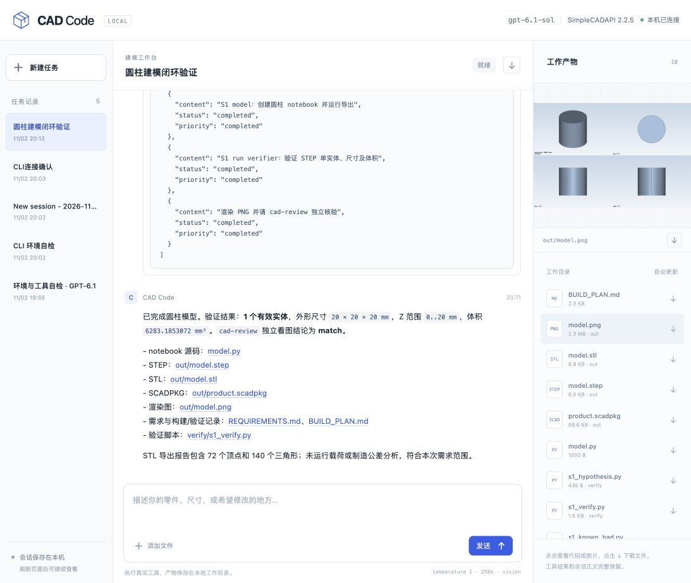

# CAD Code

基于 **OpenCode** 的本地 CAD Agent，提供终端 CLI 和网页两种交互方式。默认使用 **Qwen v8**（`qwen-v8`）、完整 **SimpleCADAPI 2.2.7 skill**（含按 STEPIR v6.2 重写的 STEP 逆向流程），执行真实建模、检查、STEP/STL 导出和渲染。

## 现在体验

在本项目目录运行：

```bash
./cad-code                         # OpenCode 交互终端
./cad-code --mini                  # 紧凑终端
./cad-code --web                   # 网页 http://127.0.0.1:8772
./cad-code --continue              # 继续上次会话
./cad-code run '做一个半径10mm、高20mm的圆柱，导出STEP、STL并渲染'
./cad-code run --file ./target.step '检查这个STEP并重建'
```

网页服务启动后，另一个终端运行 `./cad-code` 会连接同一个后端；退出该附加终端不会停止网页。启动服务的终端退出时会清理它管理的后端。CLI 与网页共用会话数据库，产物各自存入 `workspace/<session-id>/`。`--file` 复制输入到本会话 `input/`，不移动原件；单文件上限 32MiB。

每个新工作区自动创建 `tools/`，包含训练轨迹中使用的 `stepir.py`、`cadeval.py`、`families_common.py` 及评估所需配套文件、`cad.py`。它们是随项目分发的独立文件副本；继续会话时补齐缺失文件，保留已有修改。运行时提示词使用当前会话的实际工具路径。首次升级后运行 `npm run setup`，补齐 robust IoU 所需 Python 依赖。调用和来源见 [工作区工具说明](tools/README.md)。

## 独立单轮问答

`ask` 直接请求已配置的模型 API，每次只发送一条用户问题，不经过 OpenCode 或本地网关，不加载系统/环境提示词、AGENTS.md、skill、历史或工具。不启动后端，不建立会话、工作区或本地轨迹记录，已有网页/Agent 可继续运行。提供商自身的默认模板和日志策略仍由提供商决定。

```bash
./cad-code ask '什么是 STEP 文件？'
printf '计算 23 + 19，只给答案。' | ./cad-code ask
./cad-code ask --model qwen-v8 --thinking off '计算 23 + 19，只给答案。'
./cad-code ask --show-thinking '解释圆角和倒角的区别。'
./cad-code ask --help
```

标准输出只有最终答案；`--show-thinking` 将接口实际返回的思考单独写到标准错误。模型和思考配置默认沿用已有设置，命令行覆盖只影响本次请求。配置文件优先级为 `--credentials PATH`、`CAD_CODE_CREDENTIALS`、已保存配置；尚未配置时先运行 `./cad-code config`。

默认使用 `/responses`，也可用 `CAD_CODE_WIRE_API=chat ./cad-code ask '问题'` 请求 `/chat/completions`；两种协议均只有一条 user 消息。`temperature=1`、`store=false`，请求超时默认300秒，输出预算默认16384（包含思考），分别用 `--timeout` 和 `--max-output-tokens` 覆盖。stdin 原文保留；显式问题参数存在时不拼接 stdin。失败、超时、截断或没有最终文本时返回非零退出码，诊断写入标准错误，不把部分输出当成完成结果；不会自动续轮或重试。

## 配置模型 API

网页右上角点击 **API 配置**，填写 `Base URL`（例如 `https://your-provider.example/v1`）、`API key` 、模型 ID 和“开启思考”开关。点击“获取模型列表”可从服务的 `/models` 中选择；接口不支持列表时可手动填写。首次没有配置时，`./cad-code --web` 也能启动并自动显示配置面板。密钥框留空表示保留已有密钥；填写新值则替换。保存后下一次模型请求生效，正在执行的请求继续使用原配置。

终端提供同一功能：

```bash
./cad-code config                  # 交互输入地址、模型名和密钥；密钥不回显
./cad-code config --show           # 显示地址、模型名及密钥配置状态
./cad-code config --list-models    # 获取当前服务可用模型
./cad-code config --model qwen-v8  # 只切换模型，保留地址和密钥
./cad-code config --thinking off   # 关闭思考；on 为开启
./cad-code config --base-url https://your-provider.example/v1
# 从标准输入读取密钥，避免放入命令行参数或 shell 历史：
your-secret-manager-command | ./cad-code config --base-url https://your-provider.example/v1 --api-key-stdin
```

配置命令可以单独运行；后端运行时会更新同一个本机服务。托管凭据保存到 `.runtime/provider.json`，文件权限 `0600`，API 响应不包含密钥，网页也不把密钥存入 localStorage。此文件被 Git 忽略，模型执行沙盒不能读取。原有 `--credentials PATH` 方式继续可用；网页/CLI 修改会写入托管文件，不改写导入的外部凭据文件。显式启动参数或 `CAD_CODE_CREDENTIALS` 环境变量仍可覆盖保存的配置。

地址、密钥、模型名和思考开关一起保存，修改后下一次模型请求生效，无需重启。OpenCode 内部保留启动时的路由标识；网关转发的真实模型名、plugin 编译的模型身份与推理参数跟随当前选择，CLI/网页显示实际模型。所选服务需支持 Responses API、工具调用和任务所需的视觉能力；模型列表仅表示服务列出的 ID，不代表这些能力均已验证。协议通过原有 `CAD_CODE_WIRE_API` 环境变量配置，修改协议仍需重启。

## 独立管理工作区和对话

网页右上角 **数据管理** 提供两个分开的操作，每次执行前确认：

- **清理工作区**：删除输入、代码、模型和缓存；先归档完整工具执行记录，保留对话、思考、工具媒体和轨迹。继续对话时按需重新创建工作区。
- **删除对话与轨迹**：删除该会话及其子评审记录、提示词快照、关联请求/工具媒体和执行记录；代码、模型、输入文件及Git文件保留。没有对话的工作区仍出现在数据管理列表，可单独清理。

```bash
./cad-code list
./cad-code export ses_...                        # 导出到 ./ses_....json，不覆盖已有文件
./cad-code export ses_... --output trajectory.json
./cad-code export ses_... --output - | jq '.messages' # 原始 JSON 写到 stdout
./cad-code export ses_... --output trajectory.json --force # 明确覆盖
./cad-code delete workspace ses_...      # 确认后只清理文件
./cad-code delete conversation ses_...   # 确认后只删除记录
# 脚本中须明确添加 --yes；未确认不执行删除。
```

轨迹导出复用网页的 `cad-code-session-v2` JSON：保留 OpenCode 原始 `messages[].parts`（用户输入、助手 reasoning/text、工具参数和结果）以及完整 `tool_media` 图片/文字记录，不转换成 SFT 模板。输出文件创建权限为 `0600`；默认拒绝覆盖，需明确传 `--force`。`--output -` 只向 stdout 写 JSON，适合管道。

运行中的任务及子评审会拒绝删除，需先停止。对话删除不保留应用内恢复副本；归属不明或损坏的旧记录不会猜测删除，会提示数量。这里的删除是清除应用记录，不是SSD/SQLite底层取证擦除。

开启思考时，网页用小字号可折叠卡片显示接口实际返回的内容；`run`命令启用`--thinking`显示，交互TUI默认显示思考。生成开关和显示折叠分开：Qwen使用请求级`chat_template_kwargs.enable_thinking`真正关闭生成，不靠隐藏返回；关闭后旧思考记录仍保留。已知不支持关闭的GPT-6模型会明确拒绝该配置，其它模型仍需服务端支持。

旧会话若有空思考卡片，可手动运行 `node scripts/recover-reasoning.mjs ses_...`，从已保存的原始 SSE 恢复接口实际返回的内容。脚本按会话、provider item ID 和 content index 唯一匹配逐条事件；索引不明或候选重复时跳过，不生成思考、不覆盖非空内容，更新前保存原记录与来源哈希。

## 新机器安装

当前支持 **macOS**，需要 Node.js 22+、OpenCode 1.18.27、Python 3.12/3.13 和系统 `sandbox-exec`。

```bash
git clone https://github.com/Yulia2233/cad-code.git
cd cad-code
npm install -g opencode-ai@1.18.27
npm ci
npm run setup -- --python python3.12
./cad-code --credentials /absolute/path/provider.json
```

API 文件格式如下；也支持 `ccvibe.settings` 包装格式。当前本机配置使用 `~/.secrets/cad-code-qwen-v8.json`，文件权限为 `0600`，密钥不会写入项目：

```json
{"baseURL":"https://your-provider.example/v1","apiKey":"YOUR_API_KEY"}
```

首次启动只在本地记录配置文件路径，后续直接 `./cad-code`。Agent 请求的 API key 仅网关进程读取；独立 `ask` 由本次 CLI 读取配置，均不放入 CAD 执行器环境。不要提交 API 文件。完整 skill 已随项目固定，文件哈希在 `skills/manifest.json`。

## 工具与记录

Agent 调用标准 `tool_calls` 中的 `exec({code})`，JavaScript 内使用：

```javascript
const r = await tools.exec_command({cmd: "pwd"});
text(r); // 保留 output、exit_code 和运行中 session_id
const view = await tools.view_image({path: "out/model.png", detail: "original"});
image(view.image_url, view.detail);
```

支持 `exec_command`、`write_stdin`、`apply_patch`、`view_image`、`text`、`image`、`ALL_TOOLS`。OpenCode 的 `question`、`todowrite`、`task` 用于需求确认、进度和独立 `cad-review`。子评审只读父任务 `out/`，不能修改父产物。

图片调用默认经 **Responses API** 返回到原 `function_call_output`：保留 `text → image → text` 的实际顺序和原图字节，不走 OpenCode 的附件缩图/合成用户消息。`image(view)` 也可使用；仅 `await view_image()` 不展示图片。`detail=original` 明确映射为上游支持的 `high`，映射留审计；这不表示可控制模型内部的视觉编码。旧会话按原样保留。

| 位置 | 内容 |
|---|---|
| `workspace/<session-id>/` | 输入、notebook、验证脚本和 CAD 产物 |
| `workspace/<session-id>/tools/` | 本会话独立的 STEP IR、评估、坐标辅助和导出工具 |
| `workspace/<session-id>/.cad-events.jsonl` | 原始 JS、完整命令输出、错误、图像与执行记录 |
| `.runtime/xdg/data/opencode/` | OpenCode 会话数据库 |
| `.runtime/model-requests/` | 实际模型请求和完整流式返回，凭据脱敏 |
| `.runtime/tool-media/` | 按会话/工具调用绑定的完整有序文本与原图，供请求恢复和网页预览 |
| `.runtime/events.jsonl` | OpenCode 事件归档 |

网页可查看输入、接口返回的思考、正文、工具调用和结果，展开/折叠、上传文件、预览渲染、下载代码/产物和完整会话 JSON。不会宣称保存 API 未返回的内部思考。

## 配置与验证

默认 `temperature=1`、vision、262144 上下文，输出预算 16384。Qwen v8使用受支持的`reasoning_effort=medium`；完整验证结果、设计和限制见 [开发与架构报告](docs/implementation-report.md)。

当前 Qwen Responses 服务的历史助手文本要求 `input_text`；网关会对 OpenCode 的 `output_text` 回放块做兼容转换并记录审计。已恢复续轮工具调用；纯文本进度回复后提前结束仍是已知限制，不代表重建任务已完成。

前两段提示词来自 [英文系统模板](docs/system-prompt.en.md) 和 [运行时模板](docs/runtime-prompt.md) 的英文块，由 plugin 每次请求编译。模型、日期、会话工作目录、Python/skill/工具路径、输入文件和评审父路径动态填充；不会把模板占位符、中文对照或文档说明发送给模型，也不重复追加旧 OpenCode 环境信息。渲染结果及模板 SHA‑256 保存在 `.runtime/prompt-snapshots/`，CLI 和网页使用同一套编译逻辑。

```bash
npm test
```

2026-11-05 最新完整回归 **143/143 通过**，包含恢复脚本的8项新增回归；测试使用独立临时会话/目录，不删除用户已有数据。

支持通过 `CAD_CODE_MODEL`、`CAD_CODE_PYTHON`、`CAD_CODE_SKILL`、`OPENCODE_BIN` 覆盖默认组件；`CAD_CODE_WIRE_API=responses` 为默认，也可显式改为 `chat`。当前 Qwen v8 使用 `http://47.100.23.120/v1`、模型 `qwen-v8` 和 Responses 原生工具调用，默认 `temperature=1`、reasoning effort=`medium`、上下文262144、vision开启。Responses里的图片若未声明detail，会补`high`元数据并记审计，不修改原图。通过 API 配置切换地址、密钥、模型或思考无需重启；修改接口协议需重启后端。默认端口：网页8772、OpenCode18134、模型网关18135，均绑定本机。

本项目是受限兼容原型：CAD 子进程使用非交互 stdin，尚不支持 PTY；执行隔离依赖 macOS Seatbelt，Node `vm` 本身不是安全边界。详细能力边界见报告。


