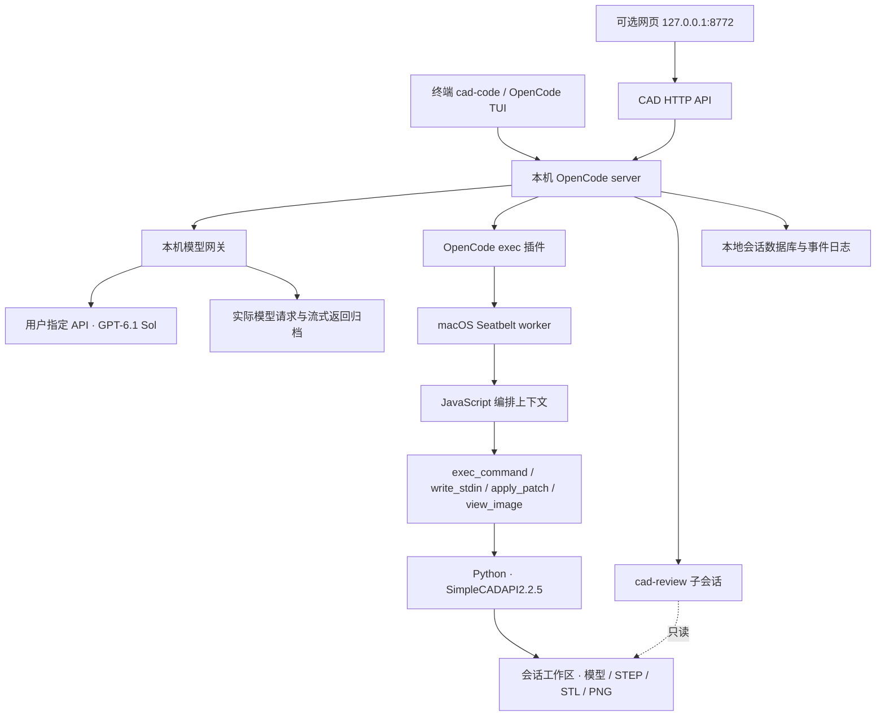
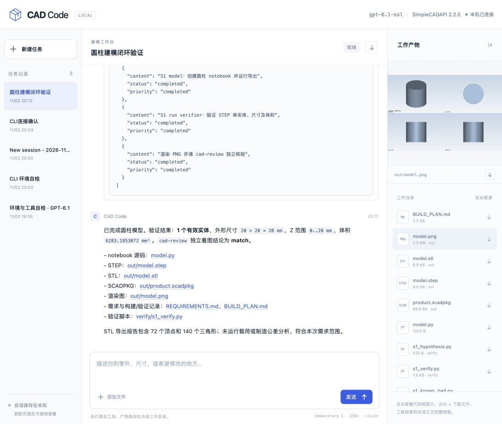

# CAD Code 开发与架构报告

日期：2026-11-02；初始版本：0.1.0。

## 交付结果

在独立项目目录实现了 **OpenCode 终端 CLI + 网页交互**，接入用户指定的 `gpt-6.1-sol`，使用完整 SimpleCADAPI2.2.5 skill。实际执行器支持千问/兼容 API 的标准 `tool_calls`，在 `exec(code)` 内运行 Codex 风格 JavaScript 编排。

已实际跑通：CLI 启动与对话 → 读取文档 → 编写可编辑 notebook → 构建几何 → 导出 SCADPKG/STEP/STL → STEP 重读验证 → PNG 渲染 → 独立模型子评审 → 最终交付。没有启动新训练，也没有修改已有训练/评测服务。

## 为什么采用这个结构

OpenCode 负责成熟的会话、模型调用、工具调度、需求问答和子任务；本项目只补 CAD 工具、运行环境、记录与体验入口。这样既能直接使用原生终端，也能在网页读取同一份会话，不需要另写一套自定义 Agent 推理循环。

工具外层采用标准 `tool_calls`，内层保留完整 JavaScript，可以保留多个调用的执行顺序、条件逻辑和显式 `text()` 输出。这避免把原始聚合反馈强行拆成猜测的子调用结果。它是后续轨迹格式对齐的基础，但本次没有实现 SFT 转换器或训练 loss mask。

## 整体架构



## 模块职责

| 模块 | 职责 |
|---|---|
| `cad-code`、`src/cli.mjs` | 统一启动入口、终端连接、run/continue/session、文件导入、后端重用与所有权清理 |
| `src/server.mjs` | 配置隔离、OpenCode 生命周期、模型网关、网页 API、会话与事件归档 |
| `src/plugin.mjs` | 注册 exec 工具、提供真实环境/skill、处理原生错误、连接独立 cad-review |
| `src/prompts.mjs` | 严格编译英文系统/运行时模板，解析动态会话字段并保存来源哈希与渲染快照 |
| `src/executor.mjs` | 每会话 worker、Seatbelt 权限、请求配对、取消、只读父产物授权 |
| `src/worker.mjs` | 执行 JS、调度子进程、补丁、图片、异步轮询及完整执行日志 |
| `src/streams.mjs` | UTF-8/SSE 分块解码、跨块凭据脱敏 |
| `src/tool-media.mjs` | 按会话/调用ID绑定原图和有序内容；校验代码/结果哈希后恢复多模态工具返回 |
| `src/cli-input.mjs` | 输入文件复制、大小限制、防覆盖与软链接/路径校验 |
| `tools/cad.py` | notebook/library 构建、包导出、STEP 检查和渲染辅助入口 |
| `public/` | 原生 HTML/CSS/JS 网页，会话、思考/调用气泡、问答、代码和渲染预览 |
| `skills/` | 完整2.2.5 skill 的固定快照；429文件及SHA-256清单 |
| `scripts/setup.mjs` | 新机器建立独立 Python 环境并安装精确2.2.5 SDK |

## 一次工具调用如何运行

```json
{"type":"function","function":{"name":"exec","arguments":{"code":"const r = await tools.exec_command({cmd:\"pwd\"}); text(r);"}}}
```

OpenCode 将 `code` 送入插件；插件选择本会话 worker，worker 在新的 JS 上下文执行。`text()`、`image()` 按实际执行顺序收集文本和原图。纯文本按原工具通道返回；图片调用原子保存至网关侧sidecar，默认经Responses的 `function_call_output.output` 数组返回。JS 语法/协议错误作为工具错误返回；错误前已输出的图片保留为错误证据。命令退出非零保留为真实观察，模型可以修改后重试；执行器不会代改模型源码或推测修复。

`exec_command` 默认等待10秒；未结束返回进程 `session_id`，后续 `write_stdin` 轮询。JS 变量不跨 exec 保留，进程 ID 在同一个存活 worker 内有效。应使用 `text(r)` 保留输出、退出码和会话 ID；仅打印 `r.output` 可能丢失仍在运行的进程 ID。

## 环境与会话

- 模型：`gpt-6.1-sol`；实际网关请求固定 `temperature=1`、`reasoning_effort=high`、`store=false`。
- OpenCode：本地1.18.27；插件依赖固定1.18.27。
- SDK：独立安装的 SimpleCADAPI2.2.5；提供完整 skill，按任务选择建模/装配/STEP/检查等流程。
- 上下文声明262144，模型输出预算16384，图像能力开启。独立评审实际读取了渲染图片。
- 自动压缩启用、`prune=false`、`reserved=1024`；精确255k触发与实际长上下文上限尚未做收费长请求验收，不能仅凭配置宣称验证完成。
- 本机开发环境借用了原cad226环境的依赖路径，SDK自身来自项目venv中的2.2.5；此路径配置不会上传。新机器安装走 `npm run setup`，安装自己的完整依赖。
- 操作者规范文档不会自动拼入模型输入。运行目录作为独立 Git 项目，避免沿父目录加载无关仓库规则；模型收到的环境信息来自本次真实会话。

每个会话使用 `workspace/<session-id>/`。CLI 文件导入与网页上传均进入本题 `input/`；原始文件保持不变。CLI 和网页共享 OpenCode 数据库、会话 ID 与产物。正在运行网页时启动 CLI 可重用其后端；附加 CLI 退出不会误杀网页服务。

## 隔离与生命周期

API 凭据只有模型网关读取；执行 worker 接收清理后的环境，不继承凭据。配置/数据库/日志和venv均由 `.gitignore` 排除，不上传仓库。模型请求不记录 Authorization header，流式归档还会跨 chunk 脱敏准确匹配的凭据。

worker 受 macOS Seatbelt 约束：写入限本会话目录；允许读取运行库、固定 skill 和必要 SDK；拒绝网络及其他会话文件。`cad-review` 的附加授权只允许读取父任务 `out/`，不能写回。Node `vm` 用于运行上下文，不是安全边界；即使 JS 取得 worker 的 Node 权限，OS 规则仍生效。

JS/命令预算目前为120秒。正常完成会清理本轮定时器；未 await 的工具调用被明确报错并销毁 worker。取消会终止 worker 及其子进程组，即使子进程忽略 SIGTERM 也会被最终强制结束。标准输出/错误按 chunk 持久化，避免取消时只等待进程自然退出而丢日志。

## 持久化与网页

OpenCode 数据库是会话的权威记录；`.runtime/events.jsonl` 归档事件，`.runtime/model-requests/` 保存实际请求和完整SSE，`.cad-events.jsonl` 保存原始JS、命令结果和图片附件。网页不截断气泡正文，折叠只影响显示；可下载整个会话JSON。思考仅展示 API 实际返回的 reasoning，不声称恢复隐藏内部思考。

网页每秒同步会话和产物，保留折叠状态与阅读位置；CLI 可以继续网页创建的任务。模型文本和代码使用文本节点显示；HTML/JS/SVG产物不会作为同源脚本执行。

## 验证与 review

初始版本自动测试34项通过；图片对齐更新后共 **62项，全部通过**：

- 执行器：JS依赖顺序、Unicode跨块、错误恢复、ALL_TOOLS、跨exec轮询、EOF/heredoc、补丁、图片附件。
- 生命周期/隔离：取消后台任务（含忽略TERM）、未await错误与立即恢复、定时器清理、跨工作区读写/软链接拒绝、凭据拒读、网络拒绝、子review只读。
- 流式处理：各字节边界UTF-8/SSE、CRLF、多行data、分块凭据脱敏和二进制保真。
- CLI输入与启动：中文文件名、原始bytes、不覆盖源文件、路径/软链接/大小校验、新建/指定/继续会话、错误退出码、所有权清理、网页保活与服务重用。
- 图片对齐：原图字节与text/image顺序、会话/调用/代码/输出绑定、并行结果、多张同图、失败证据、持久化与幂等、缺失sidecar拒绝、真实用户图片保持不变。

独立开发review发现并修复了 worker 启动权限、异步越轮写入、停止残留、UTF-8损坏、错误被误标成功、产物脚本执行、导入失败清理、CLI模型配置分歧等问题。review子智能体还实际验证了外部进程信号拒绝、只读授权与强停。

### 真实 GPT-6.1 建模验证

任务：R10mm、高20mm、底心原点、+Z单圆柱；生成可编辑notebook并导出/渲染。原生CLI执行成功并自然结束，记录了中间失败与自主修复；没有人工代写最终几何代码。

| 验证项 | 实测结果 |
|---|---|
| SDK环境自检 | 2.2.5；exit_code=0 |
| STEP | 有效；1个材料实体；尺寸20×20×20mm；Z=0..20mm |
| 体积 | 6283.185307179587 mm³，与π×10²×20一致 |
| STEP/STL/SCADPKG/PNG | 均真实生成；STEP6193B、STL7084B、包90676B、PNG2397936B |
| 独立cad-review | 实际读取PNG并检查STEP，`visual verdict: match` |
| 网页 | 已确认显示完整输入、reasoning、工具/错误、最终回复及4份产物，刷新后保留 |

首次渲染遇到SDK默认 `/tmp` 锁路径不可写，模型识别后用工作区锁路径重试成功；现已在执行器环境预设工作区内的 `SIMPLECAD_VTK_RENDER_LOCK`。该失败与修复保留在原始轨迹，不包装成一次无错通过。

## 能力边界

当前只验收macOS。PTY与向非交互命令发送非空stdin尚未实现，运行时会明确报错；只有EOF、轮询和取消通道。`ALL_TOOLS` 只包含已经实现的四个子工具。输出预算按字符近似裁剪，完整命令输出另行保存。这些都与完整Codex runtime存在差异，不能宣称逐项等价。

本次真实验证是简单圆柱，不代表复杂装配、圆角倒角、曲面逆向或长期Agent成功率已经解决。没有做新机器完整安装复现、256k收费长请求压测或训练数据mask验收；这些需要独立测试结果。

## 图片与原始轨迹对齐（2026-11-02 更新）

初始OpenCode附件通道会把图变成后续user消息，并将本例3240×2160缩为2000×1333。新路径保留原始 `tools.view_image → image()` 编排，新增调用不再经过这个附件通道；CLI和网页仍共用同一份完整记录，网页通过只读API显示原图。

worker保存有序 `input_text/input_image`，插件取得真实OpenCode `sessionID/callID`，将原始内容原子写入 `.runtime/tool-media/`。OpenCode内部只携带可核验收据，网关通过 `chat.headers` 的本机会话ID和原始工具调用，检查工具名、代码哈希、工具结果哈希，恢复对应 `function_call_output.output=[input_text,input_image,...]`。收据不会发给模型，不新增user图片消息，不猜测、拆解或修改用户图片。原图字节和尺寸、SHA‑256、detail映射进入审计。缺失记录、错误关联或上游拒绝均明确报错，禁止静默丢图/缩图/改变角色。

每个模型请求目录保存 `request.json`（OpenCode原始请求）、`forwarded-request.json`（真正发送的请求）、`media-alignment.json`（绑定与图片哈希/尺寸审计）及原始流式返回。记录在模型进程外，执行worker不能修改。新请求仅恢复仍存在的调用/结果；不会把上下文压缩移除的历史图片复活，旧会话也不回溯改写。

会话导出升级为 `cad-code-session-v2`，附带 `tool_media` 中的完整有序内容与原图，单独下载也保留工具图片证据。单个exec最多16张图、原始图片总计48MiB；完整转发请求默认最多64MiB，可用 `CAD_CODE_MAX_MODEL_REQUEST_BYTES` 调整。超限明确拒绝，不通过丢历史或缩图适配预算。

实测此GPT‑6.1供应商的Chat Completions对 `role=tool` 图片请求返回HTTP200，但模型报告没有图片；原生Responses工具图片则成功识别随机字符串。因此默认provider改为 `@ai-sdk/openai` 的Responses通道，仍由OpenCode管理Agent，不自己实现推理循环。供应商变更需重新验证，不能以HTTP200代替读图验收。

真实端到端验收：以3240×2160原图输出 `text("BEFORE_IMAGE") → image(...) → text("AFTER_IMAGE")`，转发原图bytes与本地SHA完全相同，原生工具内容顺序一致，合成user图片数为0；GPT‑6.1准确读出图内随机 `CAD-352A63`。重启后再次用旧写法 `image(r.image_url)` 验证，历史与新调用两份原图均恢复且再次准确读图。网页也已验证工具内按原顺序显示文字/图片/文字，图片naturalWidth/naturalHeight保持3240×2160。原始 `detail=original` 显式映射到API支持的 `high`，不宣称可以约束供应商内部视觉处理。这里只对齐客户端可观察的调用、内容顺序和图片数据。

官方接口依据：[Function calling](https://developers.openai.com/api/docs/guides/function-calling) 支持工具结果返回图片/文件数组；第三方供应商兼容性仍以上述实测为准。

## 英文提示词模板接入（2026-11-03 更新）

前两段分别来自 `docs/system-prompt.en.md` 全文、`docs/runtime-prompt.md` 的 English 主块及英文条件块。plugin 每次请求读取文件后编译，动态填充当前模型名/ID、上海日期、实际会话cwd/Git状态、Python、skill、工具路径、输入文件及已核实的评审父目录。两段的工作区均指本会话执行目录，避免把其他会话所在的容器目录当成授权范围。

仅在明确的 `cad-code/cad-review` agent 标记下替换原始系统段，移除旧短提示词和OpenCode自动追加的重复模型/环境信息；内部压缩及其他agent提示不套用主建模模板。review真实核实父会话后在第二段末尾加入只读角色范围，原工具权限也保持限制。模板使用单次字面替换，不执行表达式，不递归解释动态值；缺文件、未知/缺失占位符、英文块不完整或角色歧义都会明确失败。源文件哈希和实际两段保存至 `.runtime/prompt-snapshots/<session-id>/`。

本次新增23项模板及真实plugin hook测试，全量 **85/85通过**。实际OpenCode Responses请求中恰有两段developer消息，与渲染快照逐字一致，无旧尾部、中文说明和残留占位符。在线请求已到达本地网关并保存，但本次上游API返回502（独立/models探针也返回502），因此没有将模型成功回复列为本次验收结果。CLI与网页共用plugin，不依赖前端拼接提示词。

按用户指定内容接入，没有改写英文正文：系统模板要求使用用户语言，运行时模板仍要求最终中文；Python/SDK版本文字仍固定3.12/2.2.5，对应当前已配置环境。以后需要调整这两项时，应修改模板来源后重新验收，不能只改代码而让文档和实际输入分离。

## 体验入口

```bash
./cad-code              # 原生终端
./cad-code --mini       # 紧凑终端
./cad-code --web        # 网页，CLI可同时连接
./cad-code --continue   # 继续上次任务
```

网页结果示例：


